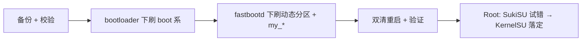

> 本文是一次真实刷机过程的记录，不是通用教程。机型、版本、分区布局任一不同，步骤都可能不适用。
> 跨区刷机有变砖风险，且全程要求 bootloader 已解锁（会清数据、可能失去保修）。
> **全程禁止重新上锁（relock）**：跨区后锁 BL 已有多起变砖案例（XDA 有 15 例只能走 EDL 救回）。
> 如果你只是想体验 OxygenOS，请优先考虑官方渠道或已验证的一键包；只有在你能接受最坏结果时，再参考下面的思路。

## 背景：这两台其实是同一台

一加 Ace 2 国行版（PHK110）与海外版一加 11R（CPH2487）是同源机型（代号 taro / SM8475 同平台），DroidWin、XDA、4PDA 上都有长期互刷的实践。这是跨区方案成立的前提：**不是所有"长得像"的机型都能互刷，同源 + 已有社区验证缺一不可**。

本次起点与终点：

| | 起点 | 终点 |
|---|---|---|
| 型号 | PHK110（Ace 2 国行） | CPH2487（11R 国际版） |
| 系统 | ColorOS 16.0.5.1201(CN01) | OxygenOS 16.0.5.1002(EX01) |
| Android | 16（补丁 2026-08-01） | 16（补丁 2026-07-01） |

主机环境：Kali Rolling x86_64，`fastboot 37.0.0` / `adb 1.0.41`（platform-tools）。本地已解压两个完整 payload（ColorOS 7.8G、OxygenOS 7.6G，各解包出 46 个 img）。

初始状态确认（动手前先摸清家底）：

- `adb shell getprop`：PHK110 / OP5913L1 / Android 16 / AB 分区。
- `fastboot getvar all`：`unlocked:yes`（已解锁），当前槽位 b（a 槽 unbootable，不碰它），super 分区 14G。
- 结论：留在 b 槽操作，bootloader fastboot 通信正常。

## 方案选择：为什么是 fastboot + fastbootd

当时对比了三家 AI 给的方案和本地资源，结论很明确：

1. **本地 OTA 走不通**。OTA 包校验机型/版本号（22803 vs 22881，PHK110 vs CPH2487），跨区直接拒绝，只能 `fastboot` + `fastbootd` 手动刷分区。
2. **版本就用手头已验证的 1002**，不追新。网上能搜到的 1301（EX01）链接无法下载，没必要为追新引入未知变量。
3. **保守分阶段**：首轮只刷 boot 系 + 动态分区 + `my_*` 定制分区；`persist / modemst / fsg / devinfo / frp / userdata / metadata`、`ocdt`、`my_company / my_preload`、xbl/abl/tz 等启动链第一阶段一律不动；不拼 Frankenstein 包（东拼西凑不同版本 img）。

流程总览：



## 阶段 A：刷机执行

### 备份与校验

```bash
fastboot devices -l
fastboot getvar unlocked      # yes
fastboot getvar current-slot  # b
fastboot getvar is-userspace  # no（确认还在 bootloader，不在 fastbootd）
fastboot getvar all > PHK110-before-fastboot.txt
```

### 坑 1：`--slot=all` + `--disable-verity` 混参导致 fastboot 挂起

第一条刷 `vbmeta` 的命令直接把 fastboot 挂死了：无回显、120 秒超时，之后所有 `getvar` 超时（但 `devices` 还看得到设备，手机屏显示正常）。

处理：手机上用音量键切到 Restart bootloader 重启，主机侧 `pkill -9 fastboot`，重连后一切恢复。

原因复盘：OPlus 的 bootloader 对 `has-slot:vbmeta/vendor_boot` 返回 Not found（只有 `boot` 支持 slot），`--slot=all` 和 `--disable-*` 混参触发了它的异常路径。**教训：OPlus 机型别用 `--slot=all --disable` 组合，老老实实分槽 plain 刷。**

### 坑 2：`AVB_MAGIC` 报错

换 `--disable` 写法刷单槽又报 `Failed to find AVB_MAGIC at offset: 0`（用 xxd 确认过文件头 AVB0 完好，纯属 bootloader 的校验逻辑问题）。最终方案：已解锁状态下，官方 OOS 签名的 vbmeta 直接 plain 分槽刷，不强求 disable patch：

```bash
cd "extracted_20261006_134553_OxygenOS CPH2487_16.0.5.1002(EX01)"
fastboot flash vbmeta_a vbmeta.img
fastboot flash vbmeta_b vbmeta.img
fastboot flash vbmeta_system_a vbmeta_system.img
fastboot flash vbmeta_system_b vbmeta_system.img
fastboot flash vbmeta_vendor_a vbmeta_vendor.img
fastboot flash vbmeta_vendor_b vbmeta_vendor.img
fastboot flash boot_a boot.img
fastboot flash boot_b boot.img
fastboot flash vendor_boot_a vendor_boot.img
fastboot flash vendor_boot_b vendor_boot.img
fastboot flash dtbo_a dtbo.img
fastboot flash dtbo_b dtbo.img
fastboot flash recovery_a recovery.img
fastboot flash recovery_b recovery.img
```

boot 系刷完（boot 192M 约 4.6 秒/槽，其余类推），进入 fastbootd 刷动态分区：

```bash
fastboot reboot fastboot   # 等约 28s
fastboot getvar is-userspace  # yes，确认已进 fastbootd

fastboot flash system system.img
fastboot flash system_ext system_ext.img
fastboot flash vendor vendor.img
fastboot flash product product.img
fastboot flash odm odm.img
fastboot flash vendor_dlkm vendor_dlkm.img
fastboot flash odm_dlkm odm_dlkm.img

fastboot flash my_bigball my_bigball.img
fastboot flash my_carrier my_carrier.img
fastboot flash my_engineering my_engineering.img
fastboot flash my_heytap my_heytap.img
fastboot flash my_manifest my_manifest.img
fastboot flash my_region my_region.img
```

**记住这条铁律：动态分区必须在 fastbootd（`is-userspace:yes`）下刷，bootloader 下只刷 boot 系。**

### 坑 3：super 空间不够，`my_product` 扩容失败

```text
Resizing 'my_product_b' FAILED (remote: 'Not enough space to resize partition')
```

根因是跨区 layout 差异：国行 `my_stock` 4.3G + `my_product` 1.4G，而 OOS 的 `my_product` 要 2.6G，此时 system 已占空间，塞不下。解法利用了"OOS 的 `my_stock` 只有 2.9G，比国行小"这一点——**先刷小的 `my_stock` 腾出 1.4G，再刷 `my_product`**：

```bash
fastboot flash my_stock my_stock.img    # 12 块，约 70s
fastboot flash my_product my_product.img  # 重试，11 块约 64s，通过
```

### 双清重启

```bash
fastboot -w   # cache not found 属正常（本机无 cache 分区）
fastboot reboot
# 约 30s 后 adb 见到设备，先是 unauthorized，手机上点允许调试即可
adb devices -l  # product:CPH2487 model:CPH2487 device:OP5961L1
```

### 验证：确实变成了 11R

```text
ro.product.model = CPH2487
ro.product.device = OP5961L1（原 OP5913L1）
ro.build.display.id = CPH2487_16.0.5.1002(EX01)
ro.build.version.security_patch = 2026-07-01
```

功能 Level2 当天全部实测通过：WiFi/蓝牙、SIM、相机、指纹、快充、GPS、NFC、界面。这意味着 modem 和 `my_carrier` 信号正常，**阶段 B（补刷 modem/my_region/启动链）暂缓**——能用就别动，这是跨区刷机最重要的纪律。

## 阶段 B：Root 路线（SukiSU → KernelSU）

目标：只动 `boot_b`（`boot_a` 永远不动，留作救生索），stock 镜像备份好并记下 SHA256。

### 弯路：自编译 Action 行不通

最初想 fork `Action_OnePlus_MKSU_SUSFS` 自编译，修了 5 个 commit（FEIL 补 `oneplus_11r_b` 分支、SUSFS 分支映射、加 SKIP_SUSFS 开关、修脚本 `cd` 缺失和 `fi` 缺失），三次触发编译全部挂掉：SUSFS 补丁打到 11r 源码报 `dentry 未初始化` 被 `-Werror` 拦截；去掉 SUSFS 纯编又倒在 SukiSU 主分支自身的 `arch.h not found`。结论：**这个 Action 是为通用 GKI `_v` 分支设计的，与 OnePlus 5.10 分叉源码不兼容**，暂停此路。

### 正路：NMS 预编译包 + `fastboot boot` 先试后固化

转用 `Bouteillepleine/OnePlus-SukiSu_NMS` 的预编译包，关键校验点：配置里的 `uname 9-o-g74d132f4467a` 与本机 `5.10.236-android12-9-o-g74d132f` 逐字吻合，且 SHA256 与发布页 CHECKSUMS 一致。11R 无可验证的第三方 Recovery，所以走 host 侧重打包路线：v4 头 + 新 Image + 原 ramdisk 合成 40M 的测试镜像，**先 `fastboot boot` 内存试启动、不写分区**：

```bash
fastboot boot SukiSU/boot-test-sukisu.img  # Booting OKAY，确认跑在 NMS 内核
adb shell su -c id  # 授权后 uid=0(root)，context 为 ksu
```

试启动验证通过后才固化到 `boot_b`，stock 的 `boot.img` / `vendor_boot.img`（SHA256 已存档）即回退手段。

### 收尾：SukiSU 隐藏线走死，转 KernelSU

SukiSU + NoMount 套件本身工作正常，但 Zygisk 层（ReZygisk 和 ZygiskNext 双实现）对 zygote 零注入（`TracerPid` 恒 0、maps 无注入痕迹），Manager 永久提示需要重启。排查到"零 Zygisk 消费模块"这一步时，判断隐藏线已经走死，果断回退：清模块、删 `/data/adb/ksu`、卸载 Manager、`boot_b` 刷回 stock（`Apr 10` 内核字样回来即确认），再用**原版 KernelSU Manager 机内补丁**重新 Root，一次成功并固化。

这段最大的经验是纪律而非技术：**一次只动一个变量**（没同时装 NoMount、没碰 system/vendor/modem/vbmeta、没锁 BL），所以每次回退都是干净、可验证的。

## 约束清单与教训

没刷的东西：xbl/abl/tz 等启动链、`ocdt`、`persist/modemst`、`my_company/my_preload`。BL 保持 unlocked，后续优先等完整版 CPH2487 full OTA（禁用增量包），大版本更新前重读 payload diff。

五条教训：

1. OPlus bootloader 禁 `--slot=all --disable` 混参，分槽 plain 刷。
2. 已解锁 + 官方签名 vbmeta，可 plain 直刷，不必死磕 disable patch。
3. super 14G 跨区必先刷小的 `my_stock` 腾空间，再刷大的 `my_product`。
4. 首刷必进 fastbootd，bootloader 只刷 boot 系。
5. a 槽 unbootable 时别切槽，留 b + 双槽刷 bootloader 分区。

---

*记录时间 2026-10-06，设备 PHK110 → CPH2487，OOS 16.0.5.1002。刷机有风险，本文记录的是"我当时这么做成功了"，不承诺在你手上同样成立。*
