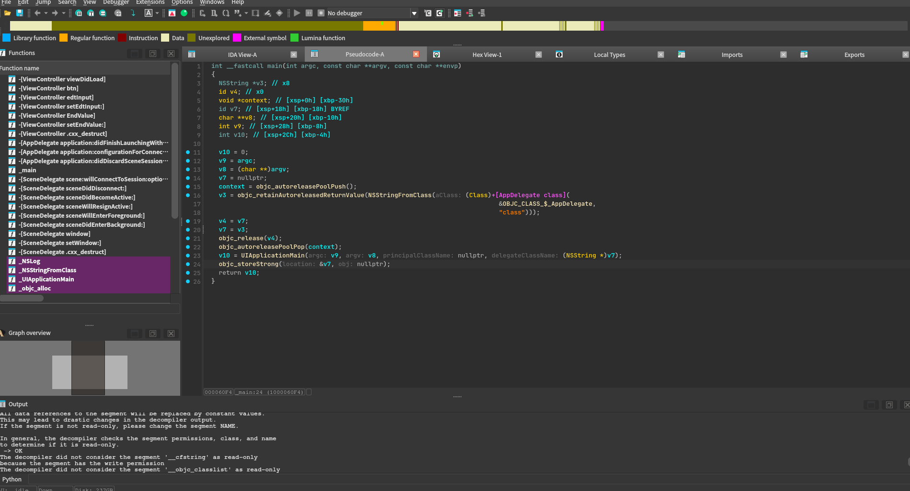
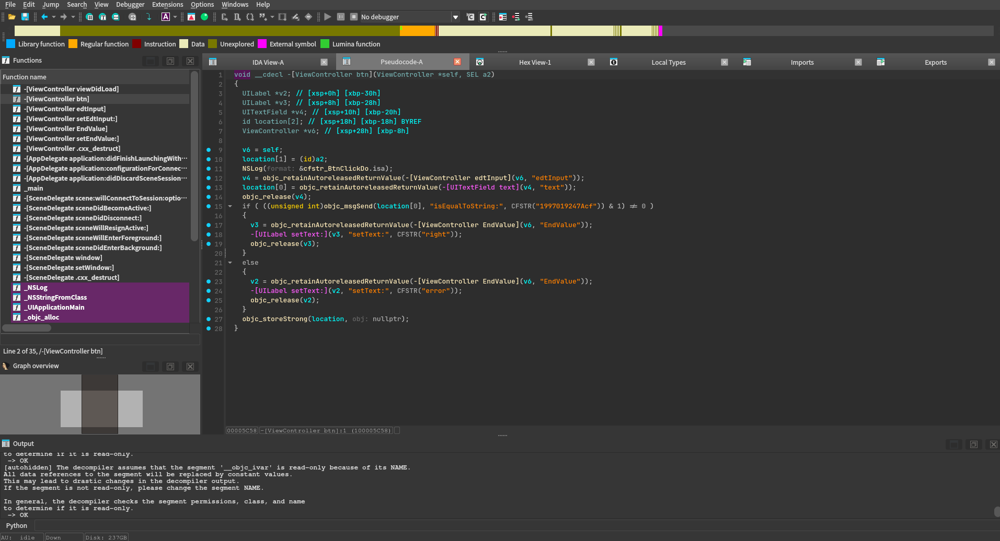

## Meta Info

[Bugku CTF - peter的手机](https://ctf.bugku.com/challenges/detail/id/359.html)

### Challenge Statement

> 题目作者：tomPeter15；提示：需要手机越狱，或者其他方式，安装第三方软件；描述：flag 格式 `flag{}`。


### Attachments

| Filename | Size | Type | SHA256 | Notes |
| ------------- | ---------- | --------------- | ------------------ | -------------------- |
| peter的手机.ipa.zip | 26977 B | ZIP | `ada42f90901222405b93fd99bc78f10d76339075bc15df492a07a8605584e092` | 外层压缩包，解出 `peter的手机.ipa`（30136 B） |
| peter的手机.zip | 30136 B | ZIP (renamed from .ipa) | `3318a7751d0c980bd557ab487f2ebf1e7feacfa2a50350e9128bdd7c2e9feadd` | IPA 本体，改后缀后解包出 `Payload/FirstOS.app/` |
| Payload/FirstOS.app/FirstOS | 81168 B | Mach-O 64-bit arm64 executable | `bd425e812c9a324b96ca2d8a470c28fb4a7bff40c2231401064883f6c0243070` | 主二进制，Objective-C，`PIE`，未见加固 |

### Environment

| Tool/Component | Version |
| -------------------- | --------------------------- |
| OS | Kali GNU/Linux Rolling x86_64 |
| 7-Zip | 26.03 |
| DiE (`diec`) | 3.21，用于确认 IPA / Mach-O 类型 |
| IDA | 本地授权版本，具体版本号待补（见 `.Environment.md`），用于查看 `-[ViewController btn]` 伪代码 |
| GNU strings (Binutils) | 2.47 |
| llvm-objdump (LLVM) | 21.1.8，用于交叉验证 Mach 头 |
| rabin2 | 6.0.5，用于确认 `lang objc / os ios` |

### Flag

```
flag{1997019247Acf}
```

---

## Summary

iOS IPA 本质是 Zip，解包出 `FirstOS`（arm64 Mach-O，Objective-C）后以 IDA 解析 ObjC 方法表，直接锁定唯一的按钮回调 `-[ViewController btn]`，反编译读出输入框文本与常量 `1997019247Acf` 的 `isEqualToString:` 明文比较，命中显示 `right`，外包 `flag{}` 提交即过。

---

## Initial Recon

### Observed Information

```bash
7z x ./peter的手机.ipa.zip
# Scanning: 1 file, 26977 bytes — Everything is Ok
# Size: 30136 (peter的手机.ipa)

diec ./peter的手机.ipa
# Archive: Zip(2.0)[24.3%, 11 files, 7 dirs]

mv ./peter的手机.ipa ./peter的手机.zip && 7z x ./peter的手机.zip
# Payload/FirstOS.app/... Folders: 7, Files: 11, Size: 107226

file Payload/FirstOS.app/FirstOS
# Mach-O 64-bit arm64 executable, flags:<NOUNDEFS|DYLDLINK|TWOLEVEL|PIE>

llvm-objdump --macho --private-header Payload/FirstOS.app/FirstOS
# MH_MAGIC_64 ARM64 EXECUTE 22 ncmds, NOUNDEFS DYLDLINK TWOLEVEL PIE

rabin2 -I Payload/FirstOS.app/FirstOS
# arch arm, bits 64, class MACH064, lang objc, os ios, compiler clang

strings Payload/FirstOS.app/FirstOS
# 全量浏览摘录：-[ViewController viewDidLoad] / -[ViewController btn]
# edtInput / EndValue / ViewController.m
# btn click do / 1997019247Acf / right / error
```

IDA 打开主二进制后，左侧 Functions 列表即解析好的 ObjC 方法表：`ViewController` 下有 `viewDidLoad`、`btn`、`edtInput` / `setEdtInput:`、`EndValue` / `setEndValue:`；Strings 窗口可见 `btn click do`、`1997019247Acf`、`right`、`error` 四个 CFString 常量，UI 侧为标准 `Main.storyboardc` 单按钮形态。

### Decision Reasoning

基于以上信息的方向判断：

- 对 `.ipa` 直接 `diec` 只看到 Zip → 这是 IPA 的正常形态（IPA 本来就是 Zip），排除“附件损坏”判断，路线是改后缀二次解包找 `Payload/*.app` 主二进制，而不是在外层 Zip 上纠缠。
- 主二进制是未加固的 arm64 Objective-C Mach-O，且符号丰富（类名、方法名、源码路径全在）→ 排除脱壳 / 混淆还原路线，主攻静态分析：以 IDA 的 ObjC 方法表为入口定位审计目标，字符串只做交叉验证。
- 方法命名自解释：`btn` 是唯一的按钮回调，`edtInput` 是输入框 outlet，`EndValue` 是结果标签 → 审计入口锁定 `-[ViewController btn]`，而不是靠预猜关键词去 grep 碰运气；Strings 窗口里的常量（点击日志、候选比对值、对错回显）后续用 xref 收敛到同一函数即可定论。

---

## Workflow

### Step 1: 两次解包定位主二进制

外层 `peter的手机.ipa.zip` 用 `7z x` 一次解出 `peter的手机.ipa`（30136 B）。对其跑 `diec` 只报 `Archive: Zip`，符合 IPA 本质，因此改名为 `.zip` 后二次 `7z x`，得到 `Payload/FirstOS.app/`（7 dirs / 11 files / 107226 B）。中途因目录已存在而出现覆盖询问，全部选 `y / a` 继续即可。

接着用 `find . -type f -exec diec` 扫全目录：只有 `Payload/FirstOS.app/FirstOS` 报 `Mach-O64`，其余是 `nib / plist / mobileprovision / IDA .til` 等资源文件，主二进制唯一。



> 两次解包 + 全目录 `diec` 收敛到唯一的 Mach-O，静态分析目标从此锁定，不再碰资源文件。

---

### Step 2: 从 ObjC 方法表锁定按钮回调

在 IDA 中打开主二进制，不需要先猜关键词过滤字符串：左侧 Functions 列表就是解析好的 ObjC 方法表，`ViewController` 类下只有 `viewDidLoad`、`btn`、`edtInput` / `setEdtInput:`、`EndValue` / `setEndValue:` 几个方法。命名直接给出 UI 结构——`btn` 是唯一的按钮回调，`edtInput` 取输入、`EndValue` 回显结果，审计入口自然锁定 `-[ViewController btn]`。

交叉验证才用到字符串：全量 `strings` 浏览与 IDA Strings 窗口中能看到同一批内容——方法名（`-[ViewController btn]`、`edtInput`、`EndValue`、`ViewController.m`）与四个 CFString 常量（`btn click do`、`1997019247Acf`、`right`、`error`）。在 Strings 窗口中对这四个常量查 xref，引用全部收敛到 `-[ViewController btn]` 内部，说明该函数同时使用了点击日志、比对值与对错回显，与方法表定位互相印证。

> 落脚点是 IDA 的方法表与 xref，而不是某组预设的 grep 关键词：先由 `btn / edtInput / EndValue` 的命名结构锁定函数，再由常量的交叉引用确认这就是唯一的判定点。

---

### Step 3: IDA 反编译按钮回调并组出 flag

在 IDA 中打开 `FirstOS`（Functions 列表可见 `- [ViewController btn]`、`viewDidLoad`、`edtInput`、`EndValue` 等），F5 得到 `-[ViewController btn]` 伪代码核心：

```objc
NSLog(@"btn click do");
NSString *input = [[self edtInput] text];
if ([input isEqualToString:@"1997019247Acf"]) {
    [[self EndValue] setText:@"right"];
} else {
    [[self EndValue] setText:@"error"];
}
```

即取输入框 `edtInput.text`，与常量 `CFSTR("1997019247Acf")` 做 `isEqualToString:` 比较，相等则标签显示 `right`，否则显示 `error`。无任何加密、哈希或网络校验，比较语义一次即确认。



按 CTF 惯例外包 `flag{}` 得到 `flag{1997019247Acf}`，提交验证通过，与 Step 2 的方法表定位互相印证。

> 明文 `isEqualToString:` 比较是全题唯一的判定点，解题在此结束，无需动态调试或 patch。

---

## Reflection

iOS 逆向的固定起手式在这题得到完整验证：`.ipa → 改后缀解包 → DiE/file 定性 → IDA 方法表 + Strings xref 定位 → 反编译读判定`。

---

## Links

- [Bugku CTF - peter的手机](https://ctf.bugku.com/challenges/detail/id/359.html)
